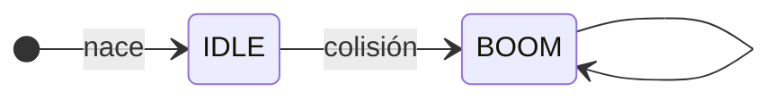

# Laboratorio 11 $\rightarrow$ Emisor y Audio

# Emisor y Partículas

En todo juego tenemos una forma de crear partículas, ya sea para crear efectos o para crear el mismo objeto muchas veces y que se muera después solito.

Para este laboratorio, lo usaremos para crear las balas de la nave. Pero antes que nada, no queremos crear siempre el objeto, si no que vamos a crear una referencia conocida como **prefab** (de pre fabricado) y cada vez que necesitemos "la partícula" vamos a copiar esa referencia y crear un objeto en base a la referencia.

Los **prefab** se pueden ver como un template de un objeto de juego, en donde se guarda completamente configurado con componentes, stats, assets

La ventaja de usarlos es:

* Portabilidad entre escenas, simplemente usas la referencia del prefab para crear el mismo objeto entre escenas
* Creación en ejecución, al correr el juego copias los atributos y métodos al crear objetos dinámicamente.


para poder lograr esto vamos a tener que modificar **TODOS NUESTROS COMPONENTES** a que se puedan clonar/copiar, creando una interfaz llamada **clonar**

## Crear método clonar en componentes

Debido a que vamos a copiar la información de un objeto y queremos que cada componente sea independiente de la referencia, es necesario crear una forma de copiar esa información y almacenarla en el objeto nuevo. por lo que se va crear una interfaz de **clonar**

**Motor/Componentes/IComponentes.hpp**
```cpp
class IComponentes
{
  public:
    virtual ~IComponentes() {};
    //Interfaz de copiar
    virtual std::shared_ptr<IComponentes> clonar() const = 0;
};
```

por lo que a cada componente hay que implementar esa función, **se proporcionará el archivo de Icomponentes de Motor y Juego, sin embargo, si tienes componentes hechos por ti, hay que implementar la función de la siguiente manera por cada componente (se hará en el HPP)**

para cada componente implementar igual solo cambiar el tipo de clase $<$ clase del componente $>$

**Motor/Componentes/IComponentes.hpp**
```cpp
class INombre : public IComponentes
{
  public:
    explicit INombre(const std::string &nom);
    ~INombre() override {};
    //implementación de la función clonar
    //hacer lo mismo en todos los componentes
    //solo cambiando la <clase> del make_shared
    std::shared_ptr<IComponentes> clonar() const override
    {
        return std::make_shared<INombre>(*this);
    };
  public:
    std::string nombre;
};
```

Hay que hacer lo mismo con los objetos en **Juego/Componentes/IJComponentes.hpp**, con todos los componentes, con todos los componentes

```cpp
class IMaquinaEstado : public CE::IComponentes
{
  public:
    explicit IMaquinaEstado();
    ~IMaquinaEstado() override {};
    //función de copiar
    std::shared_ptr<IComponentes> clonar() const override
    {
        return std::make_shared<IMaquinaEstado>(*this);
    };
  public:
    std::shared_ptr<FSM> fsm;
    bool congelar{false};
};
```

## Modificación de IMaquinaEstado,IStats y  Entidad

Como se dieron cuenta, la clase **IMaquinasEstado**, contiene un atributo llamado congelar, Esto nos va servir que en el caso de una colisión o que objetos que tengan estados tengan una acción o cambio de estados al tocarse, no este creando el mismo estado por la duración de la colisión,que solamente se cambie de estado y deshabilite el volverse a cambiar de estado.

Por ejemplo que el proyectil colisione con un objeto, el proyectil cambie de estado para mostrar la animación, al estar colisionado va crear infinidad de veces el estado de la animación, de estar forma solamente 1 vez lo crea y lo ejecuta.


Lo mismo con **IStats** para que el daño no se haga continuamente congelamos los stats

**Motor/Componentes/IComponentes.hpp**
```cpp
class IStats : public IComponentes
{
  public:
    ~IStats() override {};
    int hp;
    int hp_max;
    int str;
    int def;
    int agi;
    bool congelar{false};
    std::shared_ptr<IComponentes> clonar() const override
    {
        return std::make_shared<IStats>(*this);
    };
};
```

**NOTA**, hay componentes que no se pueden copiar como el de **IShader** o cualquiera que lo contenga, ya que SFML le borro el operador de copiar, en esos casos solamente la implementeción regresa nulo

En **Entidad** solamente actualizamos que no se cambie de FSM al estar congelado.

**Juego/objetos/Entidad.cpp**
```cpp
void Entidad::setFSM(const std::shared_ptr<FSM> &mq)
{
    // cuando llamamos setFSM con make_shared como parámetro
    // hay que congelar para que no siempre lo cambie
    if (getComponente<IMaquinaEstado>()->congelar)
        return;
    auto &estado_actual = getComponente<IMaquinaEstado>()->fsm;
    // transición de salida
    estado_actual->onSalir(*this);
    // transición de entrar a otro estado
    estado_actual = mq;
    estado_actual->onEntrar(*this);
}
```

## Componente IEmisor

Este componente lo vamos a crear en los componentes de Juego, y no será un componente puro, tendrá sus propios métodos que le ayuden administrar las partículas que se creen dentro de el emisor.

**Juego/Componentes/IJComponentes.hpp**
```cpp
class IEmisor : public CE::IComponentes
{
  public:
    explicit IEmisor(Entidad &parent, Entidad &prefab);
    ~IEmisor(void) {};
    std::shared_ptr<IComponentes> clonar() const override
    {
        return std::make_shared<IEmisor>(*this);
    };
    void onUpdate(float dt);
    void crearParticula(void);
    CE::Pool &getPool(void)
    {
        return pool;
    }
  private:
    CE::Pool pool;
    Entidad &parent; // quien tiene el emisor
    Entidad &prefab; // el objeto que se va copiar
};
```

**Nota**, en el constructor no se puso en los parámetros `const` ya que se tiene que crear métodos `const` para los setters de todo (stats, componentes etc), pero es una mejor practicar ponerlos constantes para que sea una copia pura. 

La implementación quedará de la siguiente manera

* **Constructor** asignamos las referencias de quien tiene el IEmisor y que objeto se queire copiar.
* **onUpdate** se actualizará cada partícula del emisor y borrrá la partículas después de que haya pasado un tiempo(con ITimer)
* **crearParticula** copia la configuración del prefab a la partícula y la agrega al pool de partículas del emisor.

**Juego/Componentes/IJComponentes.cpp**
```cpp
IEmisor::IEmisor(Entidad &parent, Entidad &prefab) 
    : CE::IComponentes{}, pool{1}, parent{parent}, prefab{prefab} 
{}

void IEmisor::onUpdate(float dt)
{
    for (auto &p : pool.getPool())
    {
        // asumir que tiene un timer de lo contrario crushear
        auto itimer = p->getComponente<CE::ITimer>();
        // verificar si ya llego al timer, si si poner vida 0 y borrar
        if (itimer->frame_actual >= itimer->frame_maximo)
            p->getStats()->hp = 0;
        // ejecutar update y mover?
        p->onUpdate(dt);
        SistemaMoverBalas(p, dt);
        itimer->frame_actual++;
    }
    //borar si vida es 0
    pool.borrarPool();
}
void IEmisor::crearParticula(void)
{
    auto nuevo = std::make_shared<Entidad>(prefab);
    //  calcular dirección y posición
    auto p_pos = parent.getTransformada()->posicion;
    auto n_vel = nuevo->getTransformada()->velocidad;
    nuevo->getTransformada()->angulo = parent.getTransformada()->angulo;
    float ang = nuevo->getTransformada()->angulo;
    const float pi = std::round(3.14159f * 1000.f) / 1000.f;
    const float pi_2 = std::round(pi / 2.f * 1000.f) / 1000.f;
    const float pi_4 = std::round(pi / 4.f * 1000.f) / 1000.f - 0.001f;
    const float pi_4b = std::round(3.f * pi / 4.f * 1000.f) / 1000.f - 0.001f;
    const float rang = std::round(ang * 1000.f) / 1000.f;
    // std::cout << rang << ": " << pi << ", " << pi_2 << ", " << pi_4 << ", " << pi_4b << "\n";
    auto vel = CE::Vector2D{0.f, 0.f};
    if (rang == 0.f) //arriba
        vel.y = -n_vel.y;
    if (rang == pi) // PI: abajo
        vel.y = n_vel.y;
    if (rang == -pi_4) //-pi/4:izq arriba
    {
        vel.y = -n_vel.y;
        vel.x = -n_vel.x;
    }
    if (rang == pi_4) // pi/4: der arriba
    {
        vel.y = -n_vel.y;
        vel.x = n_vel.x;
    }
    if (rang == pi_2) // PI/2: der
        vel.x = n_vel.x;
    if (rang == -pi_2) // izq
        vel.x = -n_vel.x;
    // patch el 2.3 ya que redondea extraño
    if (rang >= -pi_4b && rang <= -2.3) //-3pi/4 abajo izq
    {
        vel.y = n_vel.y;
        vel.x = -n_vel.x;
    }
    if (rang <= pi_4b && rang >= 2.3) // 3pi/4 abajo der
    {
        vel.y = n_vel.y;
        vel.x = n_vel.x;
    }
    //maquina de estados
    nuevo->getComponente<IMaquinaEstado>()->fsm = std::make_shared<BalasIdle>(1.f);
    nuevo->setFSM(nuevo->getComponente<IMaquinaEstado>()->fsm);
    // en el objeto padre la posición
    nuevo->setPosicion(p_pos.x, p_pos.y);
    nuevo->getTransformada()->velocidad = vel;
    pool.agregarPool(nuevo);
}
```
## SistemasMoverBalas

Creamos un sistema para que el proyectil se mueva

**Juego/Sistemas/Sistemas.hpp**
```cpp
void SistemaMoverBalas(const std::shared_ptr<CE::Objeto> &ente, float dt);
```
**Juego/Sistemas/Sistemas.cpp**
```cpp
void SistemaMoverBalas(const std::shared_ptr<CE::Objeto> &ente, float dt)
{
    auto trans = ente->getTransformada();
    auto vel = ente->getTransformada()->velocidad;
    trans->posicion.suma(vel.escala(dt));
}
```

Para poder utilizar el  componente IEmisor, se tiene primeramente que crear un constructor de copia

## Constructor de copia en Entidad y CE::Objeto

Vamos a copiar el estado de un objeto a otro usando un constructor de copia,

**Juego/objetos/Entidad.hpp**
```cpp
class Entidad : public CE::Objeto
{
  public:
    Entidad() = default;
    Entidad(const Entidad &cpy);
    void onUpdate(float dt) override;
    void draw(sf::RenderTarget &target, sf::RenderStates state) const override;
    // fsm
    void setFSM(const std::shared_ptr<FSM> &mq);
    void inputFSM() override;
    // versiones const
     const std::shared_ptr<CE::INombre> getNombre() const
    {
        return nombre;
    }
     const std::shared_ptr<CE::IStats> getStats() const
    {
        return stats;
    };
     const std::vector<std::shared_ptr<CE::IComponentes>> &getListaComponentes() const
    {
        return componentes;
    }
};
```

**Juego/objetos/Entidad.cpp**, aquí es donde usamos la copia de los componetes, ya que por defecto se copiaría la dirección del apuntador y tendriamos componentes compartidos entre objetos y para este caso no queremos eso, se quiere que cada objeto tenga su propio componente individual.
```cpp
static int num_cpy = 0;
Entidad::Entidad(const Entidad &cpy) 
    : CE::Objeto{cpy}
{
    nombre->nombre = cpy.getNombre()->nombre + "_" + std::to_string(++num_cpy);
    //copia profunda de los componentes
    //ya que no queremos la referencia si no un componente nuevo
    for (auto &comp : cpy.componentes)
    {
        componentes.push_back(comp->clonar());
    }
}
```

**Motor/Primitivos/Objetos.hpp**, solo el constructor vamos agregar, puse toda la clase por si acaso.
```cpp
class Objeto : public sf::Drawable, public sf::Transformable
{
  public:
    explicit Objeto();
    Objeto(const Objeto &cpy);
    virtual ~Objeto() = default;
    void draw(sf::RenderTarget &target, sf::RenderStates state) const override;
    Objeto &addComponente(const std::shared_ptr<IComponentes> &componnentes);
    template <typename T> Objeto &copyComponente(const T *componnentes)
    {
        auto copia = std::make_shared<T>(*componnentes);
        componentes.push_back(copia);
        return *this;
    }
    template <typename T> T *getComponente() const
    {
        static_assert(std::is_base_of<IComponentes, T>::value, "Solo derivados de IComponentes");
        for (auto &c : componentes)
        {
            T *comp = dynamic_cast<T *>(c.get());
            if (comp)
                return comp;
        }
        return nullptr;
    };
    template <typename T> bool tieneComponente() const
    {
        static_assert(std::is_base_of<IComponentes, T>::value, "Solo derivados de IComponentes");
        for (auto &c : componentes)
        {
            T *comp = dynamic_cast<T *>(c.get());
            if (comp)
                return true;
        }
        return false;
    };
    static int getNumObjetos()
    {
        return num_objetos;
    }
    std::shared_ptr<INombre> getNombre()
    {
        return nombre;
    }
    std::shared_ptr<ITransform> &getTransformada()
    {
        return transform;
    }
    std::shared_ptr<IStats> &getStats()
    {
        return stats;
    }
    bool estaVivo() const
    {
        return stats->hp > 0;
    }
    std::vector<std::shared_ptr<IComponentes>> &getListaComponentes()
    {
        return componentes;
    }
    void setPosicion(float x, float y);
    virtual void onUpdate(float dt) = 0;
    virtual std::string toString()
    {
        return nombre->nombre;
    }
    virtual void inputFSM() {};

  private:
    static int num_objetos;

  protected:
    std::shared_ptr<INombre> nombre;
    std::shared_ptr<ITransform> transform;
    std::shared_ptr<IStats> stats;
    std::vector<std::shared_ptr<IComponentes>> componentes;
};
```

**Motor/Primitivos/Objetos.cpp**
```cpp
int Objeto::num_objetos = 0;
Objeto::Objeto()
{
    nombre = std::make_shared<INombre>("Objeto " + std::to_string(Objeto::num_objetos + 1));
    transform = std::make_shared<ITransform>();
    stats = std::make_shared<IStats>();
    Objeto::num_objetos++;
}
Objeto::Objeto(const Objeto &cpy)
{
    //se crea espacio de memorua y se copia el contenido.
    nombre = std::make_shared<INombre>(*cpy.nombre);
    transform = std::make_shared<ITransform>(*cpy.transform);
    stats = std::make_shared<IStats>(*cpy.stats);
}
```


## Crear Maquinas de estado para las balas

Para las balas, van a tener 2 estados **Estado Idle y Estado BOOM**, ek estado normal cuando se crea y el cuando colisiona.



vamos a crear los archivos de **Juego/Maquinas/Balas/BalasIdle.cpp y .hpp** y **Juego/Maquinas/Balas/BalasBoom.cpp y .hpp**, pero antes tenemos que configurar el **Juego/Maquinas/CMakeLists.txt**

**Juego/Maquinas/CMakeList.txt**
```cmake
project(CimaEngine3v)

#todos los archivos agregados
file(GLOB_RECURSE gl_cpp RELATIVE ${CMAKE_CURRENT_SOURCE_DIR} "${CMAKE_CURRENT_SOURCE_DIR}/*.cpp")

target_sources(CimaEngine3v PRIVATE ${gl_cpp})

add_subdirectory(Naves)
add_subdirectory(Bosses)
add_subdirectory(Balas)
```

**Juego/Maquinas/Balas/CMakeLists.txt**
```cmake
project(CimaEngine3v)

#todos los archivos agregados
file(GLOB_RECURSE gl_cpp RELATIVE ${CMAKE_CURRENT_SOURCE_DIR} "${CMAKE_CURRENT_SOURCE_DIR}/*.cpp")

target_sources(CimaEngine3v PRIVATE ${gl_cpp})
```

Los folders quedan de la siguiente manera


Para la bala usaremos el siguiente sprite sheet


**Juego/Maquinas/Balas/BalasIdle.hpp**
```cpp
#pragma once
#include "../FSM.hpp"
namespace IVJ
{
class BalasIdle : public FSM
{
  public:
    BalasIdle(float max_frame_t);
    virtual ~BalasIdle() = default;
    // No se ocupa para balas, ya que vamos a manipular por fuera
    // el cambio
    virtual FSM *onInputs(const CE::IControl &control) override
    {
        (void)control;
        return nullptr;
    };
    virtual void onEntrar(const Entidad &obj) override;
    virtual void onSalir(const Entidad &obj) override;
    virtual void onUpdate(const Entidad &obj, float dt) override;
  private:
    int max_frames;
    int id_frame;
    float max_frame_time;
    float cur_frame_time;
    int t_w;
    int t_h;
};
} // namespace IVJ
```
**Juego/Maquinas/Balas/BalasIdle.cpp**
```cpp
#include "BalasIdle.hpp"
#include "Motor/Componentes/IComponentes.hpp"
namespace IVJ
{
BalasIdle::BalasIdle(float max_frame_t)
    : max_frames{1}, id_frame{0}, max_frame_time{max_frame_t}, cur_frame_time{max_frame_t}
{
}
void BalasIdle::onEntrar(const Entidad &obj)
{
    t_w = obj.getComponente<CE::ISprite>()->width;
    t_h = obj.getComponente<CE::ISprite>()->height;
}
void BalasIdle::onSalir(const Entidad &obj)
{
    obj.getComponente<CE::ITimer>()->frame_actual = 0;
}
void BalasIdle::onUpdate(const Entidad &obj, float dt)
{
    cur_frame_time -= dt;
    if (cur_frame_time <= 0)
    {
        obj.getComponente<CE::ISprite>()->m_sprite.setTextureRect(sf::IntRect(
            {
                // pos
                t_w * (id_frame % max_frames),
                0 // segundo renglón
            },
            {// dimensinones
             t_w, t_h}));
        cur_frame_time = max_frame_time;
        id_frame++;
    }
}
} // namespace IVJ
```
**Juego/Maquinas/Balas/BalasBoom.hpp**
```cpp
#pragma once
#include "../FSM.hpp"
namespace IVJ
{
class BalasBoom : public FSM
{
  public:
    BalasBoom(float max_frame_t);
    virtual ~BalasBoom() = default;
    // No se ocupa para balas, ya que vamos a manipular por fuera
    // el cambio
    virtual FSM *onInputs(const CE::IControl &control) override
    {
        (void)control;
        return nullptr;
    };
    virtual void onEntrar(const Entidad &obj) override;
    virtual void onSalir(const Entidad &obj) override;
    virtual void onUpdate(const Entidad &obj, float dt) override;
  private:
    int max_frames;
    int id_frame;
    float max_frame_time;
    float cur_frame_time;
    int t_w;
    int t_h;
};
} // namespace IVJ
```
**Juego/Maquinas/Balas/BalasBoom.cpp**
```cpp
#include "BalasBoom.hpp"
#include "Motor/Componentes/IComponentes.hpp"
namespace IVJ
{
BalasBoom::BalasBoom(float max_frame_t)
    : max_frames{3}, id_frame{1}, max_frame_time{max_frame_t}, cur_frame_time{max_frame_t}
{
}
void BalasBoom::onEntrar(const Entidad &obj)
{
    t_w = obj.getComponente<CE::ISprite>()->width;
    t_h = obj.getComponente<CE::ISprite>()->height;
}
void BalasBoom::onSalir(const Entidad &obj)
{
    (void)obj;
}
void BalasBoom::onUpdate(const Entidad &obj, float dt)
{
    cur_frame_time -= dt;

    if (cur_frame_time <= 0)
    {
        obj.getComponente<CE::ISprite>()->m_sprite.setTextureRect(sf::IntRect(
            {
                // pos
                t_w * (id_frame % max_frames),
                0 //
            },
            {// dimensinones
             t_w, t_h}));
        cur_frame_time = max_frame_time;
        if (id_frame > 2)
            id_frame = 1;
        id_frame++;
    }
}
} // namespace IVJ
```

**NOTA**, como agregamos un folder nuevo, hay que volver hacer el ensamble con `cmake -G"tu toolchain" .. -DCMAKE_BUILD_TYPE=tu perfil` o si usas multiconfig `cmake -G"Ninja Multi-Config" ..` 

## Probar Escena_SpriteTiles

Ahora si ya con todos estos cambios, vamos a crear una bala cuando el jugador presione el boton de ataque, esta bala debe de moverse en la dirección que apunta la nave y colisionar con el objeto que tiene el shader, al colisionar le debe quitar vida al objeto y eventualmente destruir.

El objeto que tenia el shader (objeto 117), en vez de llamarlo por índice vamos a crear una referencia en la escena, para poder manipuarlo sin tener que llamar el índice

**Juego/Escenas/Escena_SpriteTiles.hpp**
```cpp
#pragma once
#include <Juego/objetos/Entidad.hpp>
#include <Motor/Primitivos/Escena.hpp>
#include <memory>
namespace IVJ
{
class Escena_Sprite : public CE::Escena
{
  public:
    explicit Escena_Sprite(std::shared_ptr<Entidad> &ref);
    virtual ~Escena_Sprite() {};
    void onInit() override;
    void onFinal() override;
    void onUpdate(float dt) override;
    void onInputs(const CE::Botones &accion) override;
    void onRender() override;
    std::shared_ptr<Entidad> getJugador() override
    {
        return player;
    }
  private:
    int inicializar{1};
    std::shared_ptr<Entidad> &player;
    //se agrego esto
    std::shared_ptr<Entidad> obstaculo;
};
} // namespace IVJ
```

En la función de onInit, crearemos todo lo necesario para hacer nuestro prefab y cargar los recursos necesarios.
**Juego/Escenas/Escena_SpriteTiles.cpp**
```cpp
//incluir BalasIdle.hpp, BalasBoom.hpp
void Escena_Sprite::onInit()
{
    CE::GestorCamaras::Get().setCamaraActiva(2);
    CE::GestorCamaras::Get().getCamaraActiva().lockEnObjeto(player);
    if (!inicializar)
        return;
    registrarBotones(sf::Keyboard::Scancode::W, "arriba");
    registrarBotones(sf::Keyboard::Scancode::Up, "arriba");
    registrarBotones(sf::Keyboard::Scancode::S, "abajo");
    registrarBotones(sf::Keyboard::Scancode::Down, "abajo");
    registrarBotones(sf::Keyboard::Scancode::A, "izquierda");
    registrarBotones(sf::Keyboard::Scancode::Left, "izquierda");
    registrarBotones(sf::Keyboard::Scancode::D, "derecha");
    registrarBotones(sf::Keyboard::Scancode::Right, "derecha");
    registrarBotones(sf::Keyboard::Scancode::Enter, "aceptar");
    // lab9 colisiones
    registrarBotones(sf::Keyboard::Scancode::Space, "atacar");

    // cargar mapa
    tiles_layers.push_back(TileMap());
    tiles_layers.push_back(TileMap());
    tiles_layers.push_back(TileMap());

    // se agrego la posición inicial del tilemap --v
    tiles_layers[0].setPosition({-500, -500});
    // se agrego la posición inicial de la colisiones --v
    if (!tiles_layers[0].loadTileMap(ASSETS "/mapas/playa_col_layer1.txt", objetos, {-500.f, -500.f}))
        exit(EXIT_FAILURE);
    if (!tiles_layers[1].loadTileMap(ASSETS "/mapas/playa_layer2.txt"))
        exit(EXIT_FAILURE);
    if (!tiles_layers[2].loadTileMap(ASSETS "/mapas/playa_layer3.txt"))
        exit(EXIT_FAILURE);

    // Lab 8 animacinoes
    CE::GestorAssets::Get().agregarTextura("nave_sheet",                             // key
                                           ASSETS "/sprites/naves/player_sheet.png", // hoja
                                           CE::Vector2D{0.f, 0.f},                   // inicio
                                           CE::Vector2D{320.f, 64.f}                 // dim de la hoja
    );

    CE::GestorAssets::Get().agregarTextura("boss_sheet", ASSETS "/sprites/bosses/VileCrustaceanIdleAttack.png",
                                           CE::Vector2D{0.f, 0.f}, CE::Vector2D{924.f, 260.f});
    //texturas balas
    CE::GestorAssets::Get().agregarTextura("balas1", ASSETS "/sprites/balas1.png", CE::Vector2D{0.f, 0.f},
                                           CE::Vector2D{16 * 3, 16});
    // textura obstaculo
    CE::GestorAssets::Get().agregarTextura("sprite1", ASSETS "/sprites/sprite1.png", CE::Vector2D{0.f, 0.f},
                                           CE::Vector2D{128, 256});

    auto trans = player->getTransformada();
    trans->velocidad = CE::Vector2D{500.f, 500.f};
    player->setPosicion(462.f, 273.f);

    // Lab 8 animaciones
    auto sprite = std::make_shared<CE::ISprite>(CE::GestorAssets::Get().getTextura("nave_sheet"), // textura
                                                64, 64,                                           // dim
                                                1.f);                                             // escala

    player->addComponente(sprite);
    player->addComponente(std::make_shared<CE::IControl>());

    // lab 8 animaciones
    auto me = std::make_shared<IMaquinaEstado>();
    me->fsm = std::make_shared<IdleJugadores>();
    player->addComponente(me);
    // ejecuta onEntrar para inicializar variables
    player->setFSM(me->fsm);

    // lab9 colisiones
    // el parámetro es dim, se refiere a las dimensiones del sprite
    player->addComponente(std::make_shared<CE::IBoundingBox>(CE::Vector2D{64.f, 64.f}));

    // lab11 Prefab
    static auto bala_prefab = std::make_shared<Entidad>();
    bala_prefab->getStats()->hp_max = 1;
    bala_prefab->getStats()->hp = 1;
    bala_prefab->getStats()->str = 64;
    bala_prefab->getTransformada()->velocidad = CE::Vector2D{750.f, 750.f};
    auto bala_sprite = std::make_shared<CE::ISprite>(CE::GestorAssets::Get().getTextura("balas1"), 16, 16, 3.f);
    bala_prefab->addComponente(bala_sprite);
    bala_prefab->addComponente(std::make_shared<CE::IBoundingBox>(16));
    bala_prefab->addComponente(std::make_shared<CE::ITimer>(180)); // 3seg a 60fps
    auto bala_me = std::make_shared<IVJ::IMaquinaEstado>();
    bala_prefab->addComponente(bala_me);
    auto emisor = std::make_shared<IEmisor>(*player, *bala_prefab);
    player->addComponente(emisor);
    //fin lab11 prefab

    // shader

    // boss entidad
    auto boss = std::make_shared<Entidad>();
    // lab9 colisiones
    boss->getStats()->hp_max = 255;
    boss->getStats()->hp = 255;
    boss->getStats()->str = 150;
    boss->getStats()->agi = 50;
    boss->getStats()->def = 255;

    auto boss_sprite =
        std::make_shared<CE::ISprite>(CE::GestorAssets::Get().getTextura("boss_sheet"), 154.f, 130.f, 1.f);

    auto boss_me = std::make_shared<IVJ::IMaquinaEstado>();
    boss_me->fsm = std::make_shared<IVJ::IdleBoss>(6, 0.25f);
    auto boss_target = std::make_shared<ITarget>(nullptr);
    boss_target->setTarget(*player);

    boss->addComponente(boss_sprite)
        .addComponente(boss_me)
        .addComponente(std::make_shared<IRangoAggro>(500.f))
        .addComponente(boss_target)
        .setPosicion(500.f, 500.f);
    boss->setFSM(boss_me->fsm);

    auto shader = std::make_shared<CE::IShader>("", ASSETS "/shaders/bossfrag.frag");

    static sf::Texture boss_tex = boss_sprite->m_sprite.getTexture();

    shader->setTextura("textura", &boss_tex);

    boss->addComponente(shader);

    objetos.agregarPool(boss);

    // lab9 colisinoes
    obstaculo = std::make_shared<Entidad>();
    obstaculo->getStats()->hp_max = 100;
    obstaculo->getStats()->hp = 100;
    obstaculo->getStats()->def = 150;

    auto obstaculo_sprite = std::make_shared<CE::ISprite>(CE::GestorAssets::Get().getTextura("sprite1"), 128, 256, 1.f);
    obstaculo_sprite->m_sprite.setOrigin({64, 128});
    obstaculo->addComponente(obstaculo_sprite)
        .addComponente(std::make_shared<CE::IBoundingBox>(CE::Vector2D{128, 256}));

    obstaculo->setPosicion(1300, 175);

    auto t_shader = std::make_shared<CE::IShader>("", ASSETS "/shaders/agua.frag");
    static sf::Texture p_tex = obstaculo_sprite->m_sprite.getTexture();
    static float wescala = 0.025;
    static float vescala = 1.5;
    static float frec = 5.0;

    t_shader->setTextura("textura", &p_tex);
    t_shader->setEscalar("escala_distorcion", &wescala);
    t_shader->setEscalar("vel_distorcion", &vescala);
    t_shader->setEscalar("frecuencia", &frec);

    obstaculo->addComponente(t_shader);

    objetos.agregarPool(obstaculo);

    inicializar = false;
}
```

Creamos un proyectil al momento de presionar la tecla de atacar

**Juego/Escenas/Escena_SpriteTiles.cpp**
```cpp
void Escena_Sprite::onInputs(const CE::Botones &accion)
{
    switch (accion.getTipo())
    {
    case CE::Botones::TipoAccion::OnPress: {
        if (accion.getNombre() == "arriba")
        {
            player->getComponente<CE::IControl>()->arr = true;
        }
        if (accion.getNombre() == "abajo")
        {
            player->getComponente<CE::IControl>()->abj = true;
        }
        if (accion.getNombre() == "derecha")
        {
            player->getComponente<CE::IControl>()->der = true;
        }
        if (accion.getNombre() == "izquierda")
        {
            player->getComponente<CE::IControl>()->izq = true;
        }

        if (accion.getNombre() == "aceptar")
        {
        }
        // lab9 colisiones y lab11 prefab
        if (accion.getNombre() == "atacar")
        {
            player->getComponente<CE::IControl>()->acc = true;
            player->getComponente<IEmisor>()->crearParticula();
        }
        break;
    }
    case CE::Botones::TipoAccion::OnRelease: {
        if (accion.getNombre() == "arriba")
        {
            player->getComponente<CE::IControl>()->arr = false;
        }
        if (accion.getNombre() == "abajo")
        {
            player->getComponente<CE::IControl>()->abj = false;
        }
        if (accion.getNombre() == "derecha")
        {
            player->getComponente<CE::IControl>()->der = false;
        }
        if (accion.getNombre() == "izquierda")
        {
            player->getComponente<CE::IControl>()->izq = false;
        }
        // lab9 colisiones
        if (accion.getNombre() == "atacar")
        {
            player->getComponente<CE::IControl>()->acc = false;
        }
        break;
    }
    case CE::Botones::TipoAccion::None: {
        break;
    }
    }
}
```
Actualizamos el emisor en onUpdate y verificamos la colisión

**Juego/Escenas/Escena_SpriteTiles.cpp**
```cpp
void Escena_Sprite::onUpdate(float dt)
{

    player->inputFSM();
    player->onUpdate(dt);
    SistemaMover(player, dt);
    player->getComponente<IEmisor>()->onUpdate(dt);
    for (auto &obj : objetos.getPool())
    {
        obj->inputFSM();
        obj->onUpdate(dt);
        if (obj->tieneComponente<ITarget>())
        {
            auto &tpos = *obj->getComponente<ITarget>()->pos;
            SistemaNPCLookTarget(*obj, tpos);
        }
        // lab9
        SistemaColAABBMid(*player, *obj, true);
    }
    //lab11 prefab
    for (auto &bala : player->getComponente<IEmisor>()->getPool().getPool())
    {
        if (obstaculo)
        {
            if (SistemaColAABBMid(*bala, *obstaculo, true))
            {
                ((Entidad &)*bala).setFSM(std::make_shared<BalasBoom>(0.33f));
                bala->getComponente<IMaquinaEstado>()->congelar = true;
                // daño una sola vez
                bala->getTransformada()->velocidad = CE::Vector2D{0.f, 0.f};
                if (obstaculo->getStats()->congelar == false)
                {
                    float mitigar = obstaculo->getStats()->def / 255.f;
                    obstaculo->getStats()->hp -= (mitigar * bala->getStats()->str);
                    obstaculo->getStats()->congelar = true;
                }
            }

            if (bala->getComponente<CE::ITimer>()->frame_actual >= bala->getComponente<CE::ITimer>()->frame_maximo)
            {
                obstaculo->getStats()->congelar = false;
            }
        }
    }
    if (obstaculo)
    {
        static float acum_tiempo = 0;
        acum_tiempo += dt;
        obstaculo->getComponente<CE::IShader>()->setEscalar("dt", &acum_tiempo);
        //quitar la referencia, para que elimine el puntero
        if (obstaculo->getStats()->hp <= 0)
            obstaculo = nullptr;
    }
    // lab9 borra toda entidad que esta en el pool que hp sea <=0
    objetos.borrarPool();
}
```

finalmente pintamos las balas en pantalla

**Juego/Escenas/Escena_SpriteTiles.cpp**
```cpp
void Escena_Sprite::onRender()
{
    for (auto &al : tiles_layers)
        CE::Render::Get().AddToDraw(al);

    for (auto &obj : objetos.getPool())
    {
        // Lab 8 animaciones
        if (obj->tieneComponente<IRangoAggro>())
        {
            auto rango = obj->getComponente<IRangoAggro>();
            auto pos = obj->getTransformada()->posicion;
            rango->marcador.setPosition({pos.x, pos.y});
            CE::Render::Get().AddToDraw(rango->marcador);
        }
        CE::Render::Get().AddToDraw(*obj);
    }
    //lab11 prefab
    for (auto &p : player->getComponente<IEmisor>()->getPool().getPool())
    {
        CE::Render::Get().AddToDraw(*p);
    }
    CE::Render::Get().AddToDraw(*player);

#if DEBUG
    auto cam = &CE::GestorCamaras::Get().getCamaraActiva();
    auto csv = (CE::CamaraSnapVentana *)cam;
    auto csvpos = csv->getTransformada().posicion;
    sf::RectangleShape debugcam{{csv->m_vdim.x, csv->m_vdim.y}};
    debugcam.setOrigin({csv->m_vdim.x / 2.f, csv->m_vdim.y / 2.f});
    debugcam.setPosition({csvpos.x, csvpos.y});
    debugcam.setOutlineThickness(3.f);
    debugcam.setOutlineColor(sf::Color::Yellow);
    debugcam.setFillColor(sf::Color::Transparent);
    CE::Render::Get().AddToDraw(debugcam);
#endif
}
```

Al compilar debemos tener algo parecido:


# Sonido tetirorayo en la maquina

Para darle un poco mas de flair al juego, el motor también es capaz de cargar sonidos y música

La diferencia es que Música se puede loopear y se usa para pistas largas y los sonidos son pistas cortas, ambas puedes pausar, reproducir y parar.

Para esto usamos el **GestorAssets**, tiene métodos para cargar en memoria sonidos y música **de la misma forma que cargamos texturas**


Por como lo implemento SFML, los sonidos y música no se pueden asignar a variables ej `auto mi_sonido = CE::GestorAssets::Get().getSonido("misonido");` ya que no tienen constructor de copia/asignasión.

Por lo que se tiene que utilizar directamente del GestorAssets, los formatos que se pueden usar:

* - Sonidos cortos (WAV, OGG, FLAC)
* - Música con loop automático (WAV, OGG, FLAC)

para esto vamos a **cargar primero el sonido en la escena y lo vamos utilizar en la maquina de estados**

**Juego/Escenas/Escena_Sprite.cpp**
```cpp
void Escena_Sprite::onInit()
{
    CE::GestorCamaras::Get().setCamaraActiva(2);
    CE::GestorCamaras::Get().getCamaraActiva().lockEnObjeto(player);
    if (!inicializar)
        return;
    registrarBotones(sf::Keyboard::Scancode::W, "arriba");
    registrarBotones(sf::Keyboard::Scancode::Up, "arriba");
    registrarBotones(sf::Keyboard::Scancode::S, "abajo");
    registrarBotones(sf::Keyboard::Scancode::Down, "abajo");
    registrarBotones(sf::Keyboard::Scancode::A, "izquierda");
    registrarBotones(sf::Keyboard::Scancode::Left, "izquierda");
    registrarBotones(sf::Keyboard::Scancode::D, "derecha");
    registrarBotones(sf::Keyboard::Scancode::Right, "derecha");
    registrarBotones(sf::Keyboard::Scancode::Enter, "aceptar");
    // lab9 colisiones
    registrarBotones(sf::Keyboard::Scancode::Space, "atacar");

    //..más codigo
    // Sonido
    CE::GestorAssets::Get().agregarSonido("tetirorayo", ASSETS "/sonidos/tetirorayo.mp3");
    //..más codigo
}
```
En nuestra maquina de estados de bala la de IDLE, al momento de el estado, podemos llamar al sonido

**Juego/Maquinas/Balas/BalasIdle.cpp**
```cpp
#include "Motor/Primitivos/GestorAssets.hpp"

void BalasIdle::onEntrar(const Entidad &obj)
{
    t_w = obj.getComponente<CE::ISprite>()->width;
    t_h = obj.getComponente<CE::ISprite>()->height;
    CE::GestorAssets::Get().getSonido("tetirorayo").play();
}
//opcional se puede apagar el sonido en onSalir
// CE::GestorAssets::Get().getSonido("tetirorayo").stop();
```


**NOTA**, para un mayor y mejor control sobre el sonido, es recomendable de tener una maquina de estados dedicada a solamente el sonido, al ejecutar el código verán que si se usa una maquina para varias cosas la limitante es que es más difícil de sincronizar todo. En este caso el sonido se corta cuando se crean varias balas en sucesión

Maquinas de estado recomendadas:
* Maquina para el estado del objeto (no necesariamente con nodos)
* Maquina para la animación (con nodos)
* Maquina para los sonidos (con nodos)

(estas las juntamos en 1)

